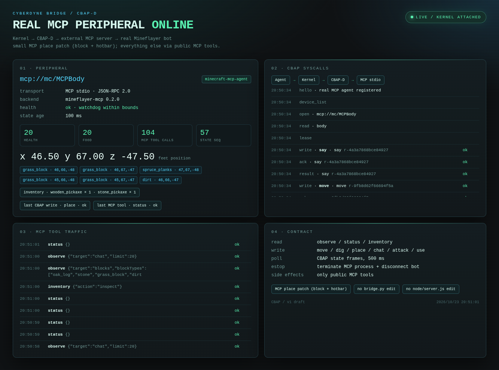

# MCP place：支撑面 / 服务端确认修复

日期：2026-10-23  
目标：修掉 `place_block: server did not confirm placement ... block is "air"`。

## 根因

不是简单的“延迟 200ms”。

原 `mineflayer-mcp` 的 `placeBlock` 逻辑是：

```text
1. 如果手上有任何非 air 物品，就把它当方块
2. 否则从背包拿第一个非 air 物品
3. bot.equip(item, "hand")
4. bot._genericPlace(...)
```

所以当手上是 **wooden_pickaxe / stone_pickaxe** 时，服务端收到的是
“用镐子当方块放置”，会静默拒绝，最后 `blockAt(target)` 仍是 air。

同时，`equip` 失败时还会 fallback 到 `stillInHand`，进一步保留错误的手持物品。
目标点如果又压着 bot 的 AABB，也会被服务端拒绝。

## 修复

在外部 `mineflayer-mcp` 副本上打一个小 patch：

```text
drivers/mcp/patches/mineflayer-mcp-place.patch
```

补丁做四件事：

1. 只从 **`blocksByName` 认识的可放置方块** 中选物品，绝不把工具当方块；
2. `place` 支持可选 `itemName`，可以明确指定要放的方块；
3. 对 hotbar 物品直接 `setQuickBarSlot`，避开 `bot.equip()` 的状态不同步；
4. 优先走公开 `bot.placeBlock(referenceBlock, faceVec)`，失败才回退
   `_genericPlace`，并延长确认等待到 300ms。

应用：

```bash
cd /path/to/mineflayer-mcp
patch -p1 < /path/to/cyberdyne-bridge/drivers/mcp/patches/mineflayer-mcp-place.patch
node --check src/bot.js
node --check src/tools.js
```

## 目标点规则

仍然必须满足：

```text
target 是 air
target 旁边/下面有 solid support
target 不与 bot 的 AABB 重叠
```

这次用安全目标实测：

```text
CBAP place p=(45,68,-47), item=spruce_planks
→ placed=spruce_planks at (45,68,-47)
```

## 实测结果

```text
place result: ok=true
world blocks:
  spruce_planks at (44,68,-47)
  spruce_planks at (45,68,-47)
  furnace at (42,68,-48)
  crafting_table at (40,68,-49)
inventory:
  wooden_pickaxe × 1
  stone_pickaxe × 1
  spruce_planks × 1
```

截图：



## 边界

- 这是外部 MCP server 的 **小型兼容 patch**；`bridge.py` 和
  `node/server.js` 仍然没改。
- 放置仍然要求真实支撑面；不能凭空在空气里放。
- 当前 MCP server 没有 stop/collect/chest/furnace 专用工具。
