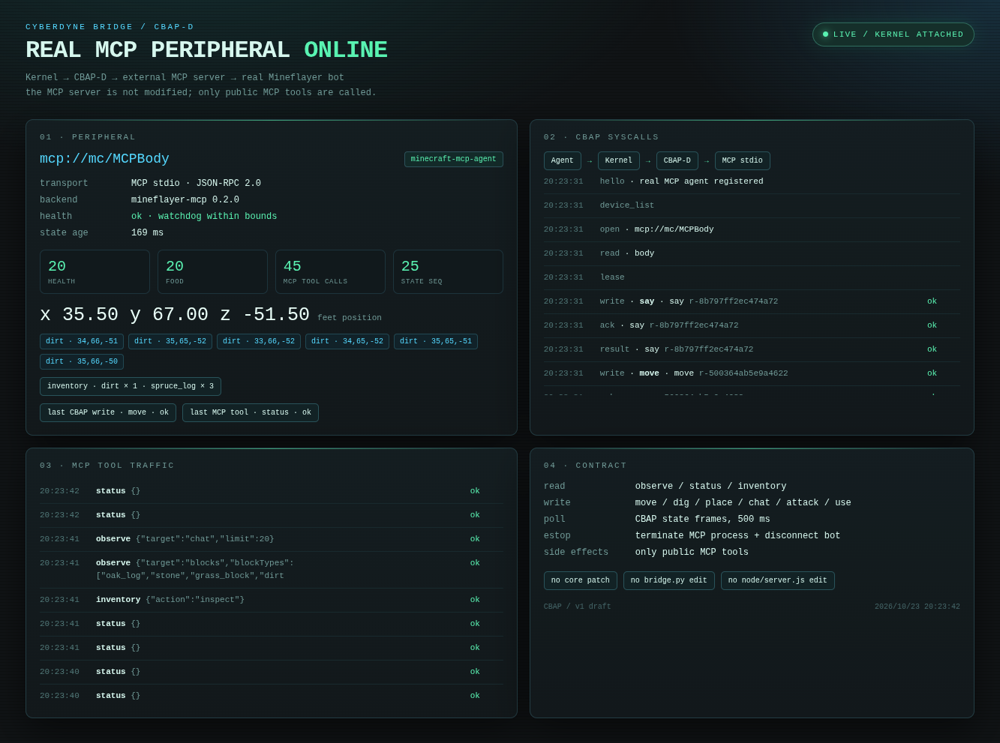

# 真实 MCP 外设 · 由本 Agent 直接当 LLM

日期：2026-10-23  
执行者：本 Agent（不是外部 LLM API）  
目标：让真实的 `MCPBody`（`swaynos/mineflayer-mcp`）通过 CBAP 完成一个实际采集任务。

## 内存清理

先停掉我们自己的旧链路，只保留真实外部 MCP 外设：

```text
停止：外挂/车钩.py（旧脑）
停止：node node/server.js（旧手）
保留：Minecraft Java server
保留：tools/mcp_dashboard.py + external mineflayer-mcp（MCPBody）
```

旧手退出日志：

```text
DeepSeek lost connection: Disconnected
DeepSeek left the game
```

## 任务

```text
去附近找一棵云杉，采集 3 个 spruce_log，并在聊天里报告。
```

这不是调用外部 LLM。是当前 Agent 自己观察、自己决定、自己通过 dashboard 的
CBAP 控制接口发动作。

## 实际执行

### 1. 观察

```text
observe blocks [spruce_log] maxDistance=64
nearest: (34, 67, -52), distance 6.285
bot:     (32.5, 62, -55.5)
```

### 2. 靠近

```text
CBAP write move p=[34,65,-52]
result: reached (34.5, 65, -52.5)
```

### 3. 采第一根

```text
CBAP write dig p=[34,67,-52]
MCP result: {"dug":"spruce_log","position":{"x":34,"y":67,"z":-52}}
掉落物在 (34.8, 67, -51.9)
CBAP write move p=[34.5,67,-52]
inventory: spruce_log × 1
```

### 4. 采第二根

```text
CBAP write dig p=[34,68,-52]
掉落物在 (33.7, 68, -51.0)
CBAP write move p=[34.5,68,-52]
inventory: spruce_log × 2
```

### 5. 采第三根

```text
CBAP write dig p=[34,69,-52]
CBAP write move p=[34.5,69,-52]
inventory: spruce_log × 3, dirt × 1
```

### 6. 报告

```text
CBAP write say text="CBAP/LLM task complete: collected 3 spruce logs"
MCP result: {"ok":true,"sent":"CBAP/LLM task complete: collected 3 spruce logs"}
```

## 证据



截图里可见：

```text
mcp://mc/MCPBody
MCP stdio · JSON-RPC 2.0
health ok
inventory · dirt × 1 · spruce_log × 3
last CBAP write · move · ok
last MCP tool · status · ok
CBAP syscalls: hello / device_list / open / read / lease / say / move
MCP traffic: status / observe / inventory
```

## 备注

- `dig` 的 CBAP 绝对坐标由 MCP driver 转成 MCP 的相对 offset；offset 用
  `floor(bot feet)` 计算，不能用四舍五入，否则会挖错方块。
- 当前 MCP server 没有 stop/collect/chest/furnace 工具；这些 op 明确 fail-closed。
- `estop` 的语义是终止外部 MCP 进程并断开 bot。
