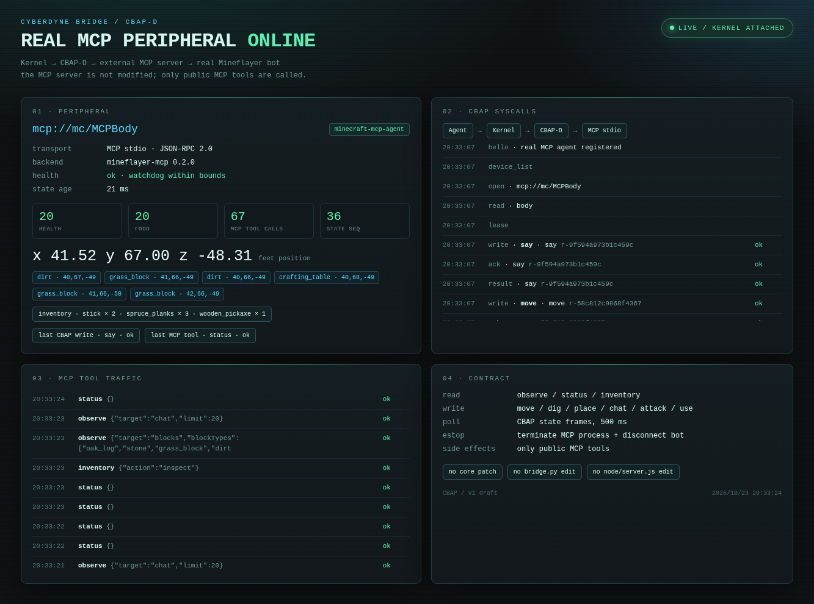

# 真实 MCP 外设 · 从原木到木镐

日期：2026-10-23  
执行者：本 Agent（不是外部 LLM API）  
外设：`mcp://mc/MCPBody`（`swaynos/mineflayer-mcp` + real Minecraft 1.21.1）

## 前置

旧链路已经停掉：

```text
mc-hand.service  inactive / disabled
DeepSeek         left the game
```

只保留：

```text
Minecraft Java server
MCPBody
CBAP dashboard
```

## 任务

```text
3 个 spruce_log
  → spruce_planks
  → crafting_table
  → 放置工作台
  → stick
  → wooden_pickaxe
```

## 实际 CBAP/MCP 结果

### 1. 木板

```text
CBAP craft item=spruce_planks count=3
→ crafted=spruce_planks count=12
   consumed.spruce_log=3
   requiresTable=false
```

### 2. 工作台

```text
CBAP craft item=crafting_table count=1
→ crafted=crafting_table count=1
   consumed.spruce_planks=4
   requiresTable=false
```

### 3. 放置工作台

第一次在树叶上放置失败：

```text
place p=(37,67,-52)
→ E_IO: no solid adjacent block to place against at offset (1,0,0)
```

随后移动到草地：

```text
CBAP move p=(39,67,-49) → reached
```

第一次 `place` 时 MCP server 的自动装备选了背包里的 dirt，放成了泥土；
随后显式执行：

```text
CBAP equip crafting_table
CBAP place p=(40,68,-49)
→ placed=crafting_table at (40,68,-49)
```

工作台现在真实存在于世界方块中，dashboard 的 block scan 能看到：

```text
crafting_table · 40,68,-49
```

### 4. 木棍

```text
CBAP craft item=stick count=1
→ crafted=stick count=4
   consumed.spruce_planks=2
   requiresTable=false
```

### 5. 木镐

```text
CBAP craft item=wooden_pickaxe count=1
→ crafted=wooden_pickaxe count=1
   consumed.spruce_planks=3
   consumed.stick=2
   requiresTable=true
```

### 6. 装备并报告

```text
CBAP equip wooden_pickaxe
→ equipped=wooden_pickaxe destination=hand

CBAP say "CBAP/LLM task complete: wooden_pickaxe built, table at (40,68,-49)"
→ ok=true
```

最终真实状态：

```text
position: [41.52, 67.0, -48.31]
health:   20
food:     20
inventory:
  wooden_pickaxe × 1
  stick × 2
  spruce_planks × 3
world block:
  crafting_table at (40,68,-49)
```

## 证据



截图里可见：

```text
mcp://mc/MCPBody
inventory · stick × 2 · spruce_planks × 3 · wooden_pickaxe × 1
crafting_table · 40,68,-49
last CBAP write · say · ok
CBAP syscalls hello/open/read/lease/say/move
MCP traffic status/observe/inventory
```

## 备注

- `place` 的 MCP 实现会自动装备背包第一个物品；要保证放的是工作台，先显式
  `equip crafting_table`。
- `craft` 的 `count` 是 MCP/Mineflayer 的配方执行次数；`3` 次木板产出 12 块。
- 当前 MCP server 没有 stop/collect/chest/furnace 工具；这些 op 继续 fail-closed。
