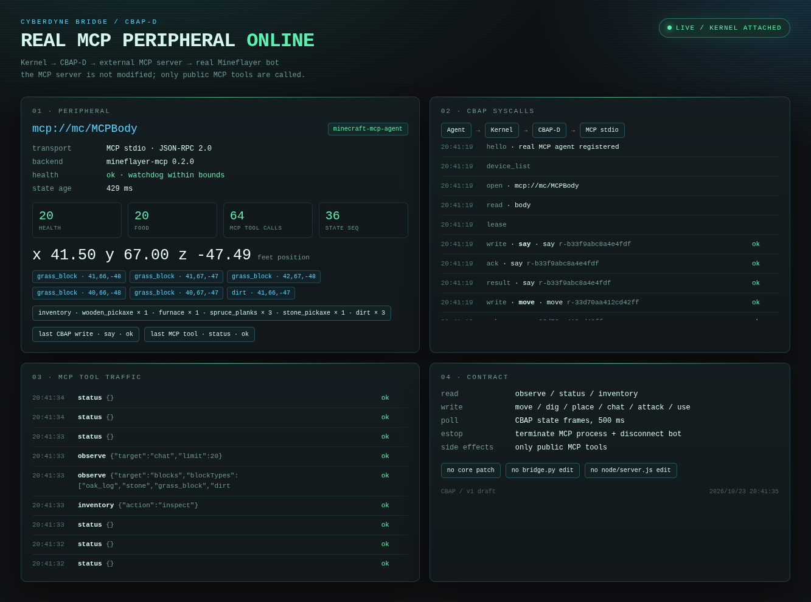

# 真实 MCP 外设 · 木镐之后：石镐与熔炉

日期：2026-10-23  
执行者：本 Agent（无外部 LLM API）  
外设：`mcp://mc/MCPBody`

## 起点

上一个任务留下：

```text
wooden_pickaxe × 1
stick × 2
spruce_planks × 3
crafting_table at (40,68,-49)
```

旧 `mc-hand` / DeepSeek 仍然保持停止，外部 MCPBody 继续运行。

## 实际执行

### 1. 用木镐挖石头

从工作面附近连续 `dig`：

```text
CBAP dig → stone
MCP → dug=stone
掉落物用 move 靠近拾取
```

挖到的 cobblestone 一部分用于工具，一部分用于熔炉。中途掉进自己挖出的竖井，
用 MCP `move` 回到地表继续。

### 2. 合成石镐

```text
CBAP craft item=stone_pickaxe count=1
→ crafted=stone_pickaxe
   consumed.cobblestone=3
   consumed.stick=2
   requiresTable=true
```

### 3. 合成熔炉

```text
CBAP craft item=furnace count=1
→ crafted=furnace
   consumed.cobblestone=8
   requiresTable=true
```

### 4. 装备石镐

```text
CBAP equip stone_pickaxe
→ equipped=stone_pickaxe destination=hand
```

### 5. 熔炉放置

尝试在工作台旁放置熔炉，MCP server 两次返回：

```text
place_block: server did not confirm placement ... block is "air"
```

所以熔炉保留在背包里，没有假装放到了世界里。工作台本身仍在：

```text
crafting_table at (40,68,-49)
```

### 6. 报告

```text
CBAP say "CBAP/LLM: stone pickaxe + furnace complete; 11 cobblestone mined"
→ ok=true
```

最终真实状态：

```text
position: [41.5, 67, -47.49]
health:   20
food:     20
inventory:
  stone_pickaxe × 1
  wooden_pickaxe × 1
  furnace × 1
  spruce_planks × 3
  dirt × 3
world:
  crafting_table at (40,68,-49)
```

## 证据



截图里可见：

```text
mcp://mc/MCPBody
health ok
inventory · wooden_pickaxe × 1 · furnace × 1 · spruce_planks × 3 · stone_pickaxe × 1 · dirt × 3
last CBAP write · say · ok
CBAP syscalls: hello / open / read / lease / say / move / equip
MCP traffic: status / observe / inventory
```

## 备注

- 熔炉已经合成，但因 MCP `place` 的服务端确认失败，没有强行声称放置成功。
- 当前 MCP server 没有 stop/collect/chest/furnace 专用工具；熔炉只是普通方块物品。
- 下一步如果要烧炼，需要先解决 `place` 的支撑面/服务端确认问题，再补 furnace 专用动作。
