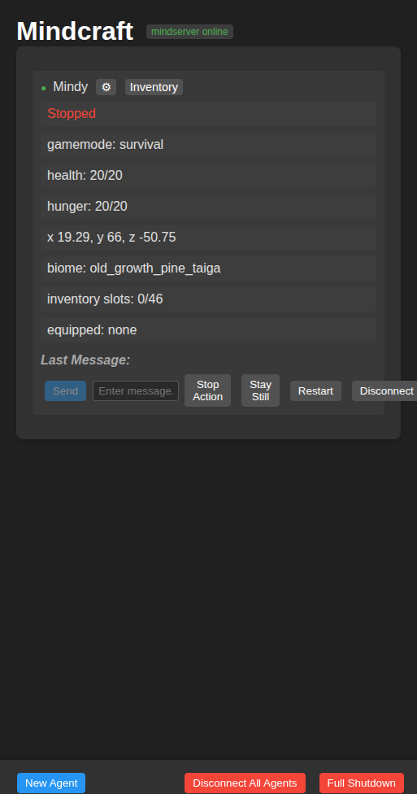

# Mindcraft 接入 CBAP

日期：2026-10-23  
目标：把 **真实自治 Mindcraft Agent** 接成 CBAP 外设，而不只是再包一个 MCP 工具层。

## 结果

接上了。

```text
Mindcraft Agent: Mindy
模型:           本地 Qwen3-4B (OpenAI-compatible lmstudio 适配)
Minecraft:      1.21.1 / offline / 127.0.0.1:25565
MindServer:     localhost:8080
CBAP device:    mc://mind/Mindy
```

真实 Mindcraft UI：



## 接入方式

### 1. Mindcraft 本身

```text
外部仓库: external/mindcraft
headless:  关闭 render_bot_view
            懒加载 prismarine-viewer / camera
依赖:      npm install --ignore-scripts
            （没有为 headless 编译 canvas/gl）
```

headless 补丁只改了两个 UI/vision 入口的**加载时机**，没有改 Mindcraft 的
planner、prompt、action 逻辑：

```text
drivers/mindcraft/patches/mindcraft-headless.patch
```

### 2. CBAP adapter

```text
drivers/mindcraft/adapter.mjs
```

它通过 MindServer 的公开 socket.io API：

```text
listen-to-agents  → 每秒 get-full-state → line-JSON state
send-message      → 把 CBAP prompt 交给 Mindcraft 自治 planner
stop-agent        → estop / stop
```

Python 侧复用 `McDriver`，设备定义：

```text
drivers/mindcraft/device.json
drivers/mindcraft/mapping.json
```

支持：

```text
read    body / inventory
write   prompt（投递给自治 planner）
        stop（停 agent）
estop   stop-agent
```

**不支持直接低层动作注入**（move/dig/place）。Mindcraft 仍然是决策者。

## 实测

```text
mindcraft_cbap.py: 8/8 checks passed
```

覆盖：

```text
CBAP device_list 看到 mc://mind/Mindy
读取真实 Mindcraft state
prompt 投递
Mindcraft 执行 !goToCoordinates，位置变化
estop accepted
estop 后 agent offline，driver.health.ok=false
```

机器结果：

- [`mindcraft-cbap.json`](mindcraft-cbap.json)

## 重要边界

这次证明的是：

```text
CBAP 能收编一个真实自治 Agent 的 state / prompt / stop
```

不是：

```text
CBAP 能直接控制 Mindcraft 的每个动作
```

`prompt` 的 `ok:true` 只表示 **消息已投递给 Mindcraft planner**，不表示动作完成。
完成必须通过后续 state 判断。

Mindcraft 的 4B 本地模型能响应、能执行显式 `!goToCoordinates`，但复杂任务可靠性
不能按大模型标准期待。

## 启动

```bash
# Mindcraft
cd external/mindcraft
PATH=... MINECRAFT_PORT=25565 MINDSERVER_PORT=8080 \
SETTINGS_JSON='{"auto_open_ui":false,...}' \
node main.js

# CBAP adapter
node drivers/mindcraft/adapter.mjs \
  --port 8080 --agent Mindy \
  --socket /tmp/mindcraft-cbap.sock \
  --moduleRoot /home/bzys17mintstart/external/mindcraft/package.json

# CBAP probe (assumes Mindy + adapter are up)
python3 tools/mindcraft_cbap.py --target 22,67,-54
```

## 下一步

如果只需要“自治 Agent 外设”，现在够了。  
如果需要 **低层动作控制**，下一步要在 Mindcraft 的 ActionManager 里加一个
受控的 command adapter；那是比当前的 state/prompt/stop 更深一层的改造。
