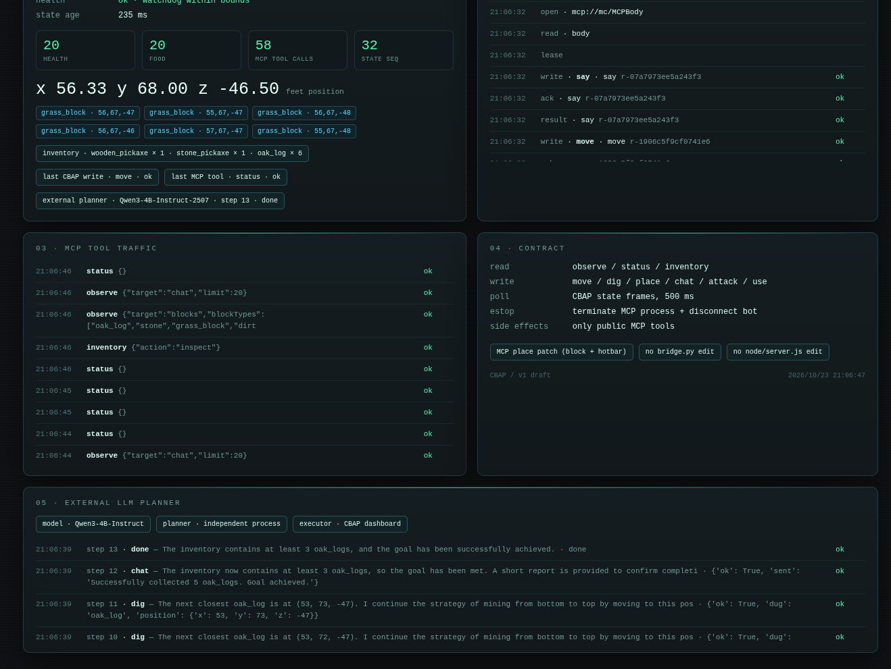

# 外部 LLM 自主性验证

日期：2026-10-23  
目标：不是我们手动发指令，而是**真实外部 LLM** 自己观察、自己选动作，
通过 CBAP 控制真实 MCPBody。

## 角色

```text
外部 LLM：Qwen3-4B-Instruct-2507
          独立 OpenAI-compatible 进程（llama-server 127.0.0.1:8099）
规划器：  tools/llm_autonomy.py
执行器：  CBAP dashboard / Kernel
身体：    mcp://mc/MCPBody（真实 mineflayer-mcp + Minecraft）
```

这次不是假 Agent，也不是本 Agent 手写下一条动作。  
`llm_autonomy.py` 只提供工具描述、状态和 JSON 校验；每一步选什么由外部模型决定。

## 任务

```text
获取至少 3 个 oak_log，完成后用聊天报告。
```

## 实际轨迹

外部模型自主产生并执行了 13 步：

```text
1  equip wooden_pickaxe
2  move  (53,67,-47)
3  dig   (53,68,-47)  → oak_log
4  move  (53,69,-47)
5  dig   (53,69,-47)  → oak_log
6  move  (53,70,-47)
7  dig   (53,70,-47)  → air（它自己判断该 log 已不在）
8  move  (53,71,-47)  → 继续找下一根
9  dig   (53,71,-47)  → oak_log
10 dig   (53,72,-47)  → oak_log
11 dig   (53,73,-47)  → oak_log
12 chat  "Successfully collected 5 oak_logs. Goal achieved."
13 done
```

最终真实状态：

```text
inventory:
  oak_log × 6
  wooden_pickaxe × 1
  stone_pickaxe × 1
position:
  [55.5, 68.0, -46.5]
```

## 验证结论

已经验证：

```text
外部 LLM 能读取 CBAP state
能选择 CBAP 支持的 action
能根据 air/错误反馈换目标
能连续执行真实世界副作用
能自己决定 chat + done
```

这证明了：**戴上项圈之后，确实是外部模型在干活，不是我们在后面牵着。**

## 发现的问题

### 1. 过度采集

模型在第 7 步已经达到 3 个 oak_log，却继续挖到 6 个才停。

原因：supervisor 只把目标写进 prompt，没有硬门禁。

已在 `tools/llm_autonomy.py` 加入 **goal gate**：

```text
if oak_log >= 3 and action not in (chat, done):
    reject with GOAL_GATE
    say: send chat then done
```

下一次运行会在达标时禁止继续消耗世界。

### 2. 模型对“相邻位置”的理解不稳

它有时把 move 目标选到 log 自身的坐标，但 MCP 的 reach/路径容错让它仍然成功。
这不是安全保证；后续需要在 supervisor 层做 **目标点 AABB / 支撑面校验**，
而不是相信模型的空间推理。

### 3. 这是 4B 本地模型

它能完成短链路，但不代表复杂规划可靠。  
这次的验证目标是“外部自主性通路”，不是“模型能力上限”。

## 证据



截图包含：

```text
external planner · Qwen3-4B-Instruct-2507 · step 13 · done
外部 planner 的 step 1..13 动作与理由
inventory · oak_log × 6
CBAP 真实动作结果
```

## 下一步

```text
1. 用 goal gate 重跑，验证恰好停在 3 个
2. supervisor 层校验 move/dig 目标点，不信任模型坐标
3. 接第二个真实异构 Agent，做并发隔离
4. 故障注入：kill MCP、estop、租约过期
```
